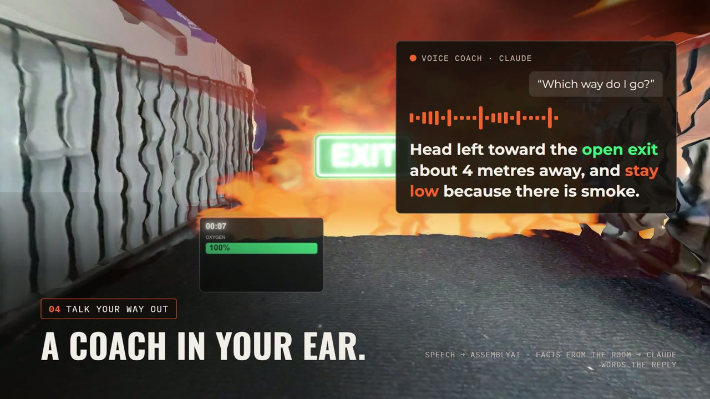

# FireDrill AR 🔥

**Turn any real room into a fire drill you can see, hear and feel.**

**[▶ Try the live demo](https://firedrill-ar.vercel.app)** (desktop Chrome, mouse and keyboard)



Built in one day at the **MOLTEN Spatial Hackathon** (LA Tech Week, Oct 17, 2026), Worldbuild track.

## The problem

Most fire drills are a calm walk down a hallway: no smoke, no heat, no panic. Live-fire training is dangerous and expensive, so almost nobody practises getting out of a smoky room.

## What it does

1. **Scan the room.** A headset scan of a real room becomes the stage, so the drill knows where the floor, furniture and doors are. No 3D skills needed.
2. **Start a fire.** Pinch where it should start, or just say "fire". Flames catch on the real counter and spread cell by cell across the floor and furniture while smoke banks down from the ceiling.
3. **Find the way out.** EXIT and BLOCKED signs appear on the real doors, and arrows on the floor point a route that avoids the fire.
4. **A coach in your ear.** Ask "which way do I go?" and Claude answers from the actual room state: where you are, where the fire is, which exits are open, how deep the smoke is.
5. **Feel it.** DataFeel Dots on both wrists warm up on the side the fire is on, buzz when your head is in the smoke, and go cool when you reach the safe exit.
6. **Get a score.** Escape time, oxygen left, time in smoke and how much of the time you stayed low.

## Try it

**[firedrill-ar.vercel.app](https://firedrill-ar.vercel.app)** runs the drill on our real room scan in the browser:

| Key | Action |
|---|---|
| Load example drill | Fire, exits and a blocked door already placed |
| `1` `2` `3` `4` | Place fire · mark exit · mark blocked door · set the trainee's start (click on the scan) |
| `Space` | Start the drill |
| `W` `A` `S` `D`, drag, `C` | Walk, look, crouch under the smoke |
| `Q` | Ask the voice coach |
| `R` / `Esc` | Reset / stop |

The hosted version has no backend, so the voice coach uses built-in replies and the haptics panel shows "server unreachable". The full experience (Claude coach, live speech, wrist haptics) needs the Python server below.

## How it works

```
 Vision Pro / Quest (WebXR)  ─┐                         ┌─ Claude: voice coach replies
 Desktop observer + demo     ─┼─ Vite (HTTPS) ── /py ──► Python server ─┼─ AssemblyAI: streaming speech
 three.js scene, fire, smoke ─┘                         └─ DataFeel Dots: heat, cold, buzz, LEDs
```

- **`web/`**: Vite + three.js. `effects.js` (fire spread, smoke, signs), `drill.js` (timer, oxygen, review), `hud.js`, `voice.js` (AssemblyAI streaming + commands), `heat.js` (which wrist faces the fire).
- **`server/`**: FastAPI. `/agent` (Claude coach), `/token` (temporary AssemblyAI token), `/ws/heat` (haptics), and `dots.py`, the DataFeel driver with skin-safe limits (38 °C max, automatic cut-outs).
- **`10_17_2026/`**: the room scan used everywhere (OBJ + baked textures).
- **`unity/`**: a phone-AR fire prototype (ARCore/ARKit).

## Run it locally

Needs Node 20+ and Python 3.11.

```bash
cd web
npm install
npm run dev
```

Open `https://localhost:5173/demo.html` and accept the self-signed certificate. Other pages: `/` (desktop observer), `/effects-test.html`. The Vision Pro page uses its own config: `npm run dev -- --config vite.eileen.config.js`, then `/eileen-xr.html`.

For the coach, speech and haptics, run the server in a second terminal (Windows: `py -m venv .venv` and `.venv\Scripts\activate`):

```bash
cd server
python3 -m venv .venv
source .venv/bin/activate
pip install -r requirements.txt
cp .env.example .env
uvicorn app:app --host 0.0.0.0 --port 8000
```

Put your `ASSEMBLYAI_API_KEY` and `ANTHROPIC_API_KEY` in `server/.env`. Vite proxies `/py` to `http://localhost:8000`, or to `PY_SERVER` if set. Check `https://localhost:5173/py/health`.

## Tech

Apple Vision Pro and Meta Quest (WebXR) · three.js · Vite · Claude · AssemblyAI · DataFeel · FastAPI · Unity

## Team

Prakhar · Varnika · Eileen · Devaj · Emma

Flame flipbook: Unity Labs (CC0). Build notes, contracts and the day's plan: [HANDBOOK.md](HANDBOOK.md).
